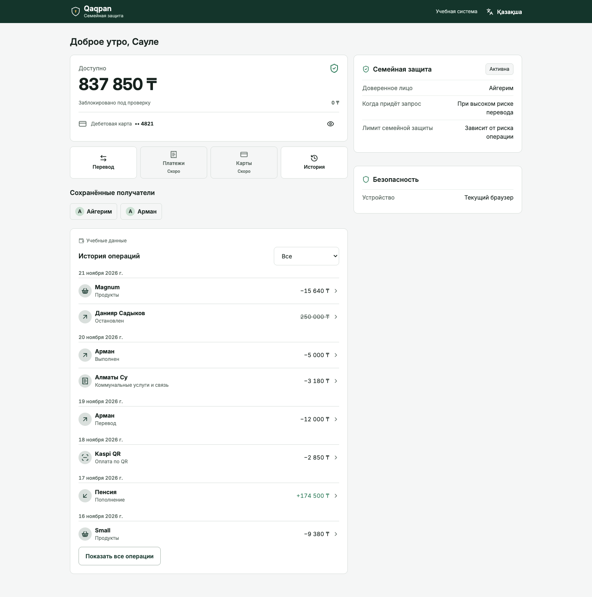
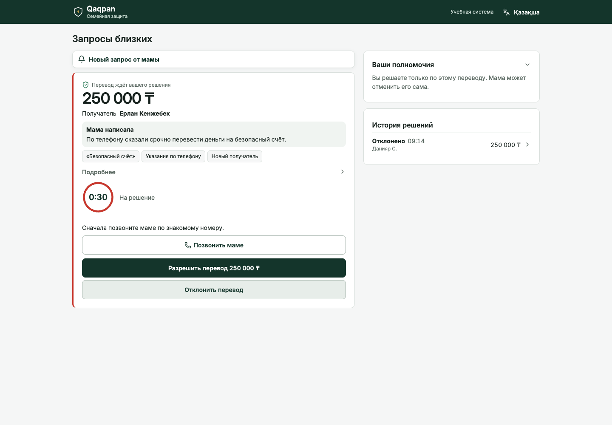
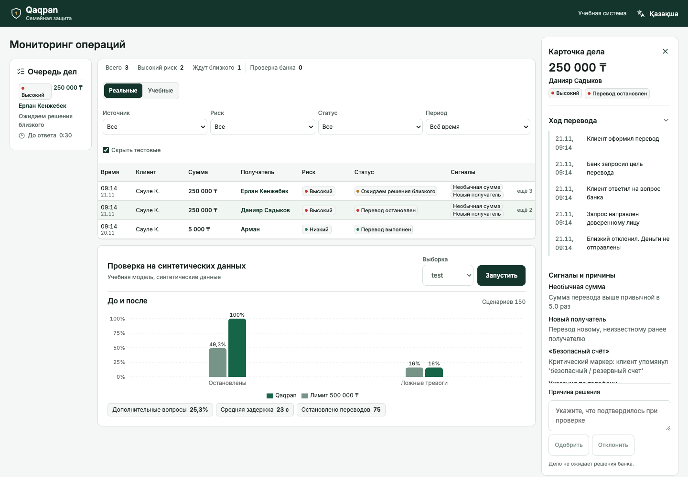

# Qaqpan: семейная защита от телефонного мошенничества

Хакатон Банка ЦентрКредит. Учебный прототип, данные синтетические.

Телефонный мошенник убеждает человека самостоятельно отправить деньги. Со стороны банка такой перевод может выглядеть как обычная операция, которую клиент подтвердил сам. Qaqpan приостанавливает подозрительный перевод до отправки денег и даёт семье время проверить его.

## Как это работает

1. Система оценивает риск по сумме, новому получателю, времени и признакам дробления. При необходимости она учитывает смысл ответа клиента на русском или казахском.
2. Перевод с низким риском (LOW) проходит сразу. При среднем риске (MEDIUM) банк спрашивает цель перевода. При высоком риске (HIGH) запрос получает доверенное лицо. Деньги остаются на счёте до решения.
3. Доверенное лицо может разрешить или отклонить перевод. Если оно не ответило вовремя, клиент может отменить перевод или запросить проверку банка.
4. Аналитик видит дела, сработавшие сигналы и ход перевода, принимает решения по запросам на проверку и запускает симулятор «До и после». SSE обновляет экраны ролей при изменении статуса перевода.

| Клиент | Доверенное лицо | Аналитик |
| --- | --- | --- |
| [](docs/screenshots/client-1440.png) | [](docs/screenshots/trusted-1440.png) | [](docs/screenshots/analyst-1440.png) |

## Результат на синтетических данных

Отдельная выборка `holdout3` не использовалась при настройке правил.

| | Простой лимит 500 000 ₸ | Qaqpan |
| --- | --- | --- |
| Остановлено сценариев | 20 % | 64 % |
| Ложные тревоги | 4,44 % | 4,44 % |

Данные синтетические, модель учебная, цифры не переносятся на реальный банк.

[Презентация Qaqpan](https://drive.google.com/drive/folders/1-0w36mG3sEH-IbE6MhXsFq7L_KcSXZMB?usp=sharing)

## Запуск

Нужны Python 3.11+, Node.js 20.9+, npm, make и lsof. Выполните из корня репозитория.

```bash
python3 -m venv backend/.venv
backend/.venv/bin/python -m pip install -r backend/requirements.txt
npm ci --prefix frontend
cp frontend/.env.example frontend/.env.local
make dev
```

На чистой SQLite-базе при запуске появится одна учебная операция. `Ctrl+C` останавливает оба сервера.

- [Клиент](http://localhost:3000/client)
- [Доверенное лицо](http://localhost:3000/trusted)
- [Аналитик](http://localhost:3000/analyst)
- [API и документация](http://localhost:8000/docs)

## Сценарий проверки (2 минуты)

1. Откройте три окна для клиента, доверенного лица и аналитика. Запомните доступный баланс клиента.
2. У клиента нажмите «Перевод» и «Заполнить пример». Продолжите и подтвердите 250 000 ₸. Если система спросит цель, ответьте «По телефону сказали срочно перевести деньги на безопасный счёт».
3. В окне доверенного лица запрос появится автоматически. Нажмите «Отклонить перевод».
4. У клиента появится «Перевод остановлен». Вернитесь к счёту и проверьте, что доступный баланс вернулся к исходному и сумма перевода не списалась.
5. У аналитика откройте остановленный перевод. В блоке проверки на синтетических данных нажмите «Запустить», чтобы увидеть график «До и после».

## Стек

- FastAPI, SQLAlchemy, SQLite и SSE.
- Next.js, React и TypeScript.
- Правила скоринга и разбор цели перевода на русском и казахском.

## Разбор ответа и симулятор

Ответ клиента на русском или казахском проходит разбор на признаки социальной инженерии. Правила скоринга используют эти признаки для выбора следующего шага. Если задан `GEMINI_API_KEY`, парсер обращается к Gemini. Без ключа, при сетевой ошибке или тайм-ауте работает локальный разбор по правилам. Для подключения Gemini скопируйте `backend/.env.example` в `backend/.env` и задайте ключ. Параметры модели и тайм-аута в примере соответствуют значениям по умолчанию в коде.

Симулятор сравнивает порог перевода в 500 000 ₸ со скорингом Qaqpan на синтетических данных. В интерфейсе доступны `test` и отдельная выборка `holdout3`. Отчёт показывает долю остановленных сценариев обмана, ложные тревоги, долю дополнительных проверок и среднюю моделируемую задержку. Задержка рассчитана симулятором.

Рабочие эндпоинты Али используют интегрированные модули Арсена с последующими доработками, включая признаки предоплаты и метрики дополнительных проверок. Исходный снимок Арсена сохранён в [backend/reference/backend2-d72bd8b](backend/reference/backend2-d72bd8b).

## Ограничения

- Прототип работает с учебной моделью и синтетическими данными.
- Связь клиента и доверенного лица задана в демо. Учётные записи и получение согласия сторон отсутствуют.
- Часть истории и баланс на клиенте смоделированы.

## Команда

- Backend — Али (API, автомат состояний, SSE) и Арсен (скоринг, ИИ-парсер, симулятор).
- Frontend и дизайн — jqlow.
- Презентация — Мухаммеджан.

[Внутренний регламент хакатона](CONTRIBUTING.md)
